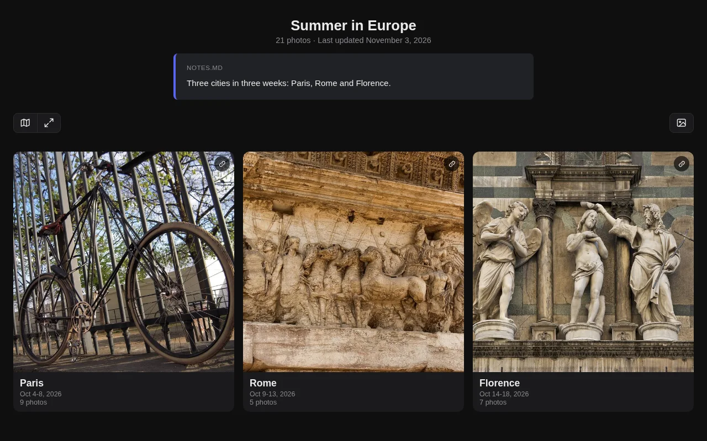
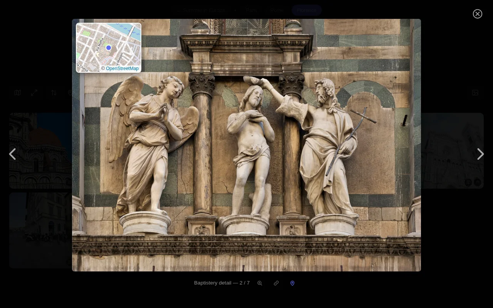
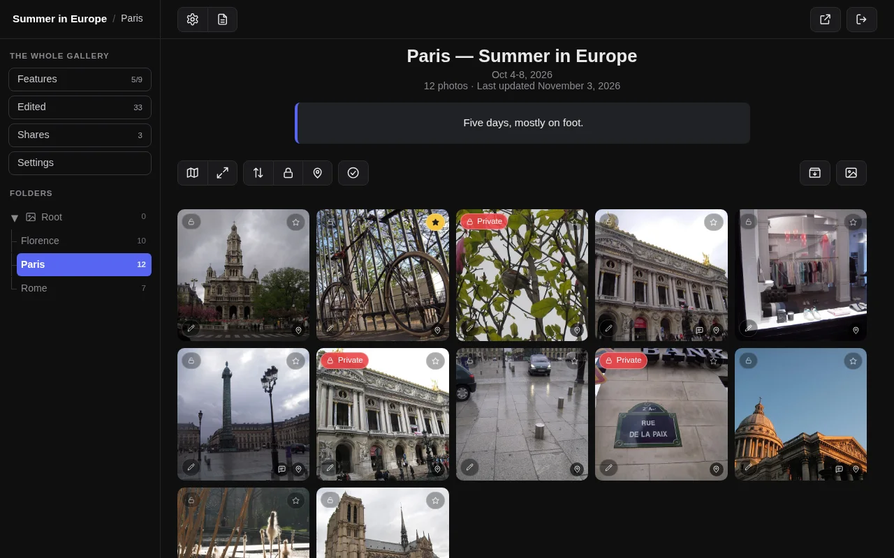
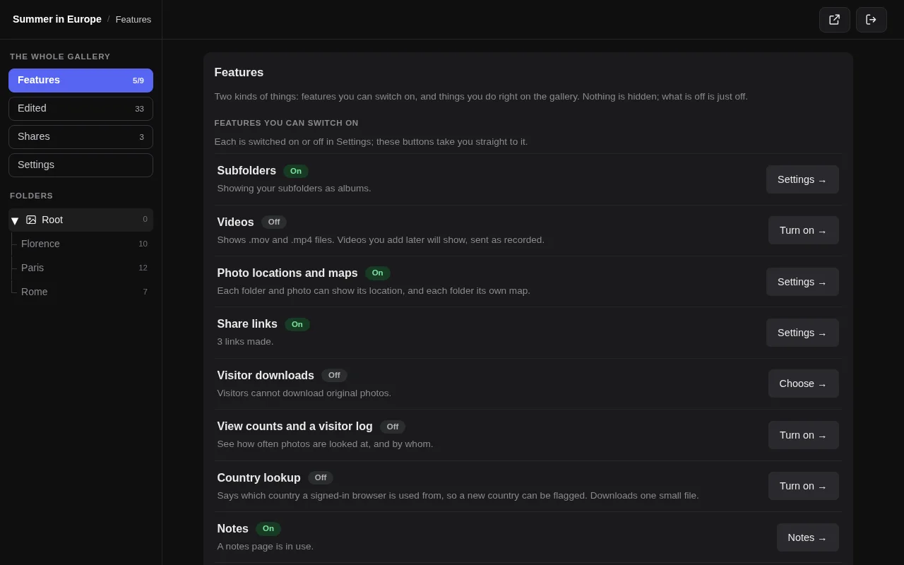
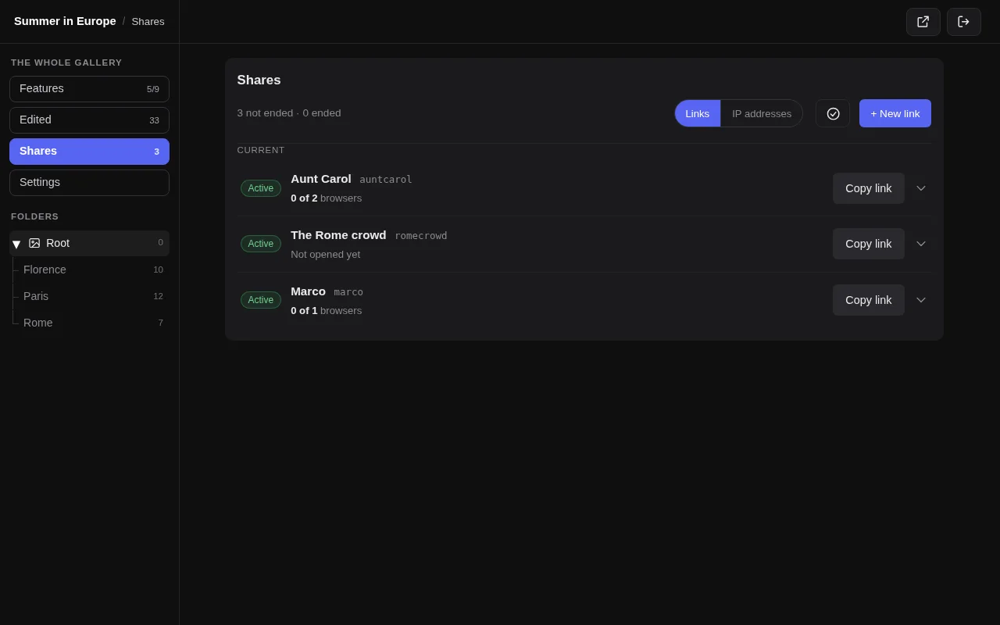
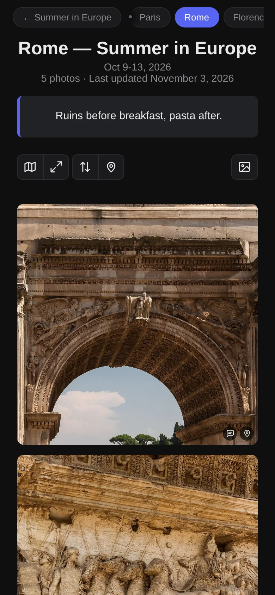
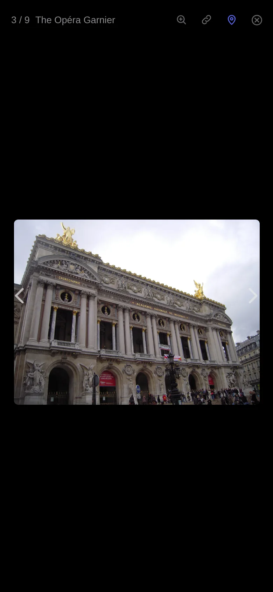
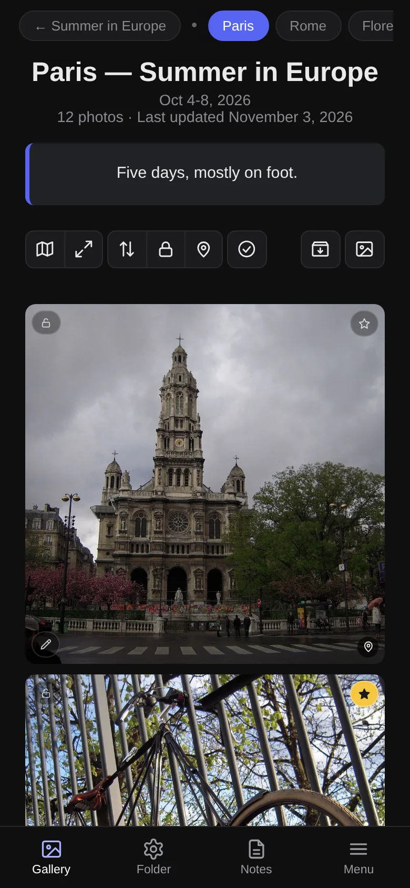
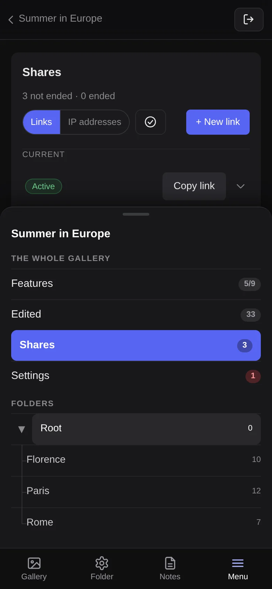

# Gallery

**A single-file, drop-in PHP photo gallery** for trips, family albums and "for sale" listings. No database, no dependencies, no build step: put `index.php` in a folder of photos and it shows a gallery.

<p align="center">
<a href="https://github.com/pcmike/gallery/releases/latest"></a>
<a href="docs/guide/getting-started.md"></a>
<a href="LICENSE"></a>
</p>

<p align="center"></p>

## Why you might like it

- **One file.** Upload `index.php`, open the folder in a browser, done. Folders become albums, to any depth.
- **Made for phones as much as computers.** A sharp, fast grid, a full-screen viewer with swipe, captions and a small map, and an admin that works with your thumb.
- **Private photos you can still share.** Hide any photo or folder, then send a temporary link that shows only what you chose, can be limited to a number of browsers or a date, and can be paused or revoked at once. You see who opened it.
- **Edit on the page.** A pencil on every photo for the caption, place and privacy; select many photos to change them together.
- **Everything is opt-in.** Maps, video, subfolders, share links and passwords stay off until you switch them on, and the admin says what each one publishes. Nothing leaves your server unless you turn it on (a map loads its tiles from OpenStreetMap when someone opens one).
- **Looks after itself.** A health check for the server, a built-in backup of everything it has made, and guarded data files.

## Quick start

1. **Download** `index.php` from the [latest release](https://github.com/pcmike/gallery/releases/latest).
2. **Put it in a folder of photos** on any host with PHP 8.3 or newer. Open that folder's address: it is a gallery.
3. **Open `?admin`** (for example `https://example.com/trip/?admin`). The first time, it asks for a code from a small file it made beside `index.php`, then for the password you want.

```
your-folder/
  index.php     <- this file
  photo1.jpg
  Rome/         <- a folder becomes an album
```

More: [Getting started](docs/guide/getting-started.md), with recipes for a plain gallery, a for-sale listing, a trip album, private photos and iPhone photos.

## See it

<table>
<tr>
<td width="50%"><br><sub><b>The viewer:</b> arrow keys and swipe, captions, links, a map when the photo has a place.</sub></td>
<td width="50%"><br><sub><b>The admin shell:</b> your folders on the left, your gallery on the right; private photos are marked.</sub></td>
</tr>
<tr>
<td width="50%"><br><sub><b>Features:</b> everything you can switch on, and where each one stands.</sub></td>
<td width="50%"><br><sub><b>Share links:</b> who it is for, how many browsers have opened it, and a button to copy it.</sub></td>
</tr>
</table>

<table>
<tr>
<td width="25%"><br><sub><b>On a phone</b></sub></td>
<td width="25%"><br><sub><b>The viewer</b></sub></td>
<td width="25%"><br><sub><b>Your page, signed in</b></sub></td>
<td width="25%"><br><sub><b>The Menu</b></sub></td>
</tr>
</table>

*The screenshots show a demo gallery of public-domain photographs ([credits](docs/images/CREDITS.md)).*

## What it does

- **Albums and notes:** folders, captions, places, Markdown notes with sold/reserved markers, photo order you control. [Notes, folders and the viewer](docs/guide/notes-and-folders.md)
- **Private items and share links:** hide photos, then send links that show only what you choose. [Private items, share links and sharing](docs/guide/private-and-sharing.md)
- **The admin:** a shell on computers, a bottom bar on phones, a health check, a list of every signed-in browser with its address history. [The admin](docs/guide/admin.md)
- **Settings:** every setting, its default and where to change it. [Settings](docs/guide/settings.md)
- **Servers:** locking down the data files, nginx and Apache rules, troubleshooting, security. [The server](docs/guide/server.md)
- **Upgrading:** what changes at each version, and what to back up. [Upgrading and backups](docs/guide/upgrading.md)

The full manual is in **[docs/guide](docs/guide/README.md)**. What changed in each version is in the [CHANGELOG](CHANGELOG.md); an example notes file is in [examples](examples/example-forsale.md).

## Status

A personal project, actively developed. Contributions: see [CONTRIBUTING](CONTRIBUTING.md).

**License:** MIT with the [Commons Clause](https://commonsclause.com), see [LICENSE](LICENSE). In plain words: use it, change it and share it freely, for yourself or for your own business's gallery; you may not sell it, or sell a product or service (including hosting or paid support) whose value comes mainly from it. Versions up to 2.4.1 were released under plain MIT and stay that way.

---

created by [github.com/pcmike](https://github.com/pcmike)
